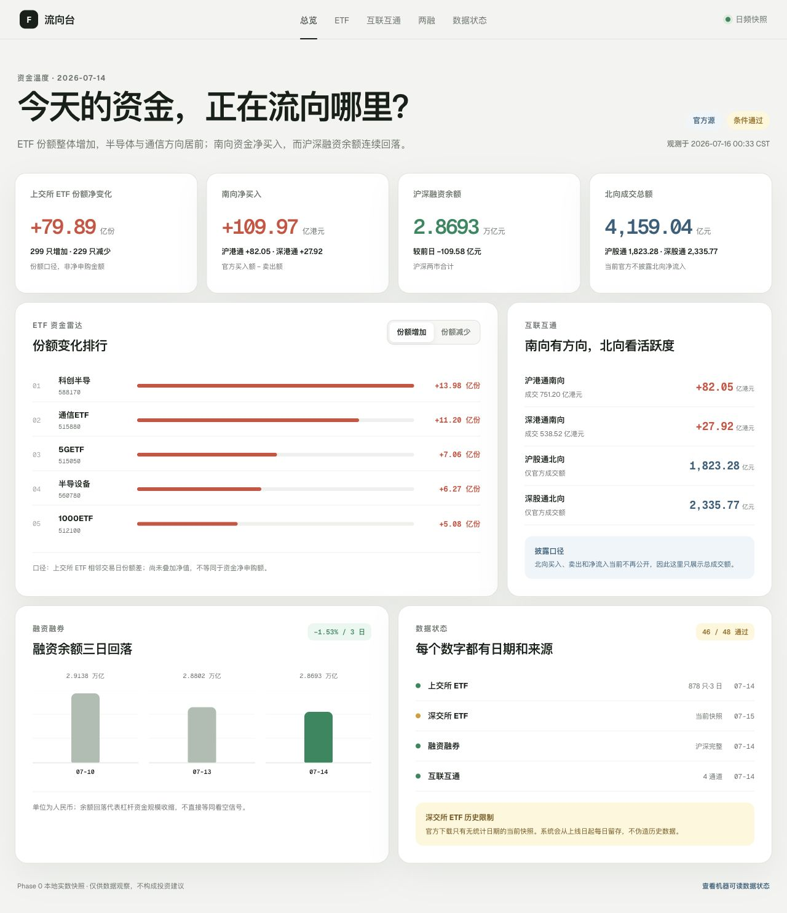
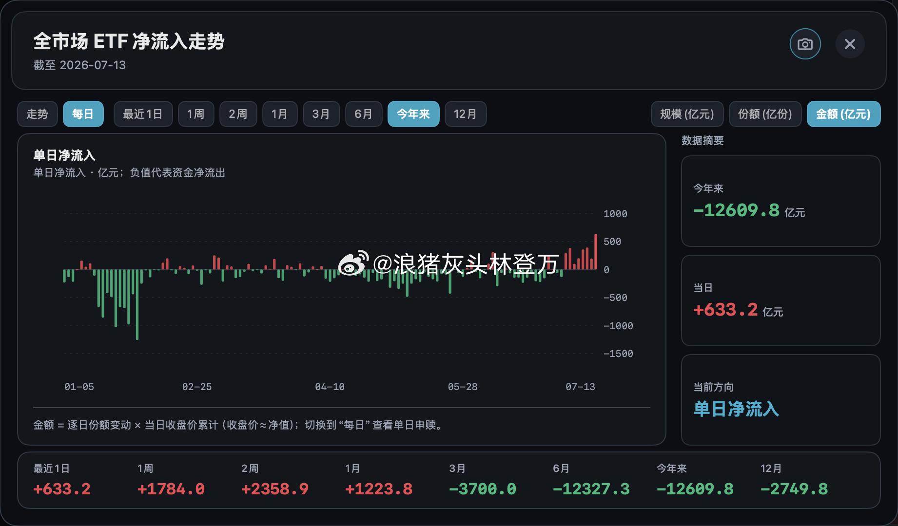
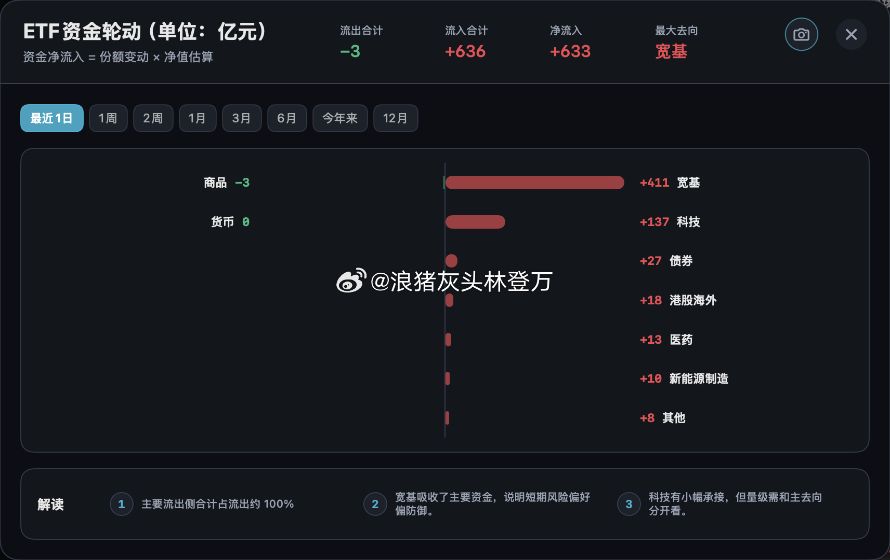
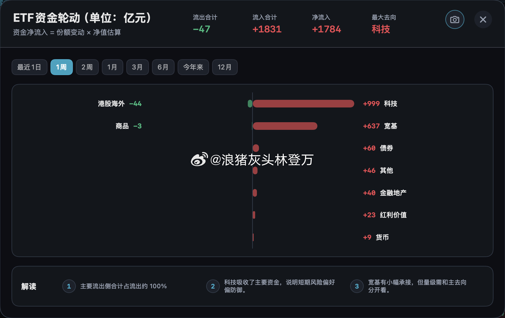
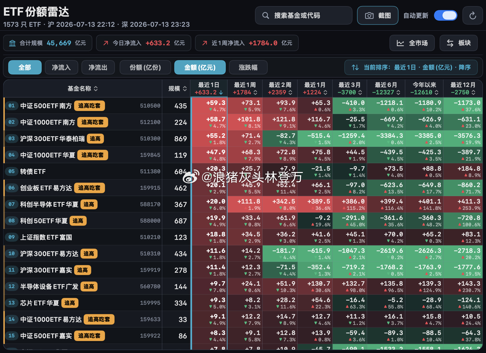

# Flow 参考图逆向产品审计

日期：2026-07-16

## 1. 审计范围

- 当前 Flow 首页：日频快照、四个市场指标、ETF 份额排行、互联互通、两融和数据状态。
- 用户提供的 7 张参考图：板块轮动、ETF 趋势、ETF 轮动、ETF 热力雷达，以及作为边界参考的持仓穿透界面。
- 用户目标：个人在每个交易日快速判断 ETF、互联互通和两融资金的去向、持续性与拥挤程度。
- 2026-07-16 用户决策：ETF β 压强及个股持仓穿透不进入产品范围。

## 2. 总体结论

当前版本是可信的“当日摘要”，但还不是“交易工作台”。它缺的不主要是视觉密度，而是三个产品能力：

1. **时间维度**：从 1 日快照变为 1 日/1 周/2 周/1 月/3 月/6 月/年初至今/12 月的可比较时间序列。
2. **实体下钻**：市场 → 板块 → ETF，每一层都可点击下钻并保留口径、日期和覆盖率。
3. **横截面比较**：不只显示 Top 5，而是通过热力表、筛选、排序、标签和组合条件在全市场中找出异常和持续性。

产品定位应升级为：**一个可解释的日频资金研究台，而不是一张资金日报。**

## 3. 证据与步骤健康度

### Step 0：当前 Flow 首页 — 健康，但只达到摘要层



优点：数据口径诚实，官方值与估算值没有混合，已有日期、质量状态和北向披露限制。

主要缺口：数据维度少、不能切周期、不能筛选排序、不能从板块下钻 ETF、没有全市场横截面。页面更像编辑式报告，不像可操作工作台。

### Step 1：板块资金轮动 — 目标模式，需要重建数据层


这不是普通排行榜，而是“资金从哪里撤出、流向哪里”的市场地图。需要板块分类、多周期聚合、流入/流出分解、主线、轮动速度和拥挤度。

### Step 2：全市场 ETF 趋势 — 目标模式，受历史覆盖率约束



需要单日与累计两种口径，同时支持规模、份额和估算金额切换。必须显示 `coverageStart`/`coverageEnd`，不得将深市尚未积累的历史当作零值。

### Step 3：ETF 板块轮动 — 目标模式，需要统一分类





同一张图在 1 日和 1 周下的主线会变化，这是这组图的核心价值。必须先建立“宽基/行业/策略/主题/跨境/债券/商品/货币/其他”主分类和版本化映射，否则轮动图会重复计算或分类漂移。

### Step 4：ETF 份额雷达 — 必做，是主要工具屏



这一屏才是个人每日使用最高频的工具：全市场表格、多周期热力、流入/流出、份额/金额/涨跌幅、排序、搜索和状态标签。点击 ETF 应进入历史明细，而不是停在 Top 5。

### Step 5–6：持仓穿透参考 — 明确排除

参考图仍作为数据信任边界的设计证据保留，但不实现持仓分摊、个股穿透排行和历史回放，也不为它们预留导航入口或数据表。

## 4. 目标信息架构

```text
市场总览
├─ 板块资金轮动（1日/1周/2周/1月/3月/6月/YTD/12月）
├─ ETF 全市场趋势
├─ 互联互通摘要
└─ 两融摘要

ETF 份额雷达
├─ 全市场多周期热力表
├─ 宽基/行业/策略/主题/跨境筛选
└─ ETF 详情：日频、累计、量价、规模、来源与覆盖

互联互通
├─ 南向 1/5/20 日净买入与活跃股
└─ 北向成交额、活跃股与季度持仓（不伪造净流入）

融资融券
├─ 市场汇总和趋势
├─ 行业融资余额变化
└─ 个股增减榜与价格对照

数据与口径
├─ 数据日历、覆盖率和 stale 状态
└─ 指标公式、源站、发布版本和异常记录
```

## 5. 建议的指标定义

| 指标 | 可解释定义 | 等级 |
|---|---|---|
| ETF 估算净申购 | `(当日份额 - 前日份额) × 当日净值`，净值未出时用收盘价并降级 | B |
| 板块净流入 | 板块内所有主分类 ETF 估算净申购求和 | B |
| 拥挤度 | 流入前 3 板块占全部正流入的比例，0–100% | B |
| 轮动速度 | 当前窗口与前一等长窗口的 Top 板块加权 Jaccard 差异，0 表示稳定，100 表示完全换挡 | B |
| N 日主线 | N 日累计净流入、连续流入天数和覆盖率联合排名第一 | B |
| 融资余额变化 | 当日融资余额 - 前日融资余额，不命名为“净流入” | B |

“追高/吃套”等标签不应在第一版直接模仿。它需要“资金加权进场成本”与当前价格的严格定义，否则只是强情绪标签。首版显示流入和价格收益的二维事实，等口径验证后再生成标签。

## 6. 数据架构缺口

| 需要新增 | 用途 | 主要风险 |
|---|---|---|
| `dim_instrument` | ETF/股票/指数统一主数据 | 代码、更名、退市与市场映射 |
| `dim_etf_classification` + 生效日 | 宽基/行业/策略/主题等主分类 | 重复归类与历史漂移 |
| `fact_etf_daily` 扩展 | 份额、净值、收盘价、规模、成交额、收益 | 深市官方历史不足 |
| `agg_etf_period` | 1/5/10/20/60/120/250 日估算金额与份额聚合 | 窗口覆盖不足不能当零 |
| `agg_etf_group_period` | 板块轮动和主线 | 分类版本必须可重算 |
| `fact_margin_security_daily` | 个股融资融券 | 两市字段与单位不同 |
| `data_coverage` | 各实体/指标的可用区间与等级 | 必须在 API 和 UI 中一起返回 |

架构上仍建议使用 GitHub Actions + Python + R2 + D1 + Worker，不需要换基础设施。新增 Apache ECharts（Apache-2.0）和 TanStack Table（MIT）即可完成图表与高密度表格，继续保持开源与免费优先。

## 7. 实施顺序

### v0.2：先做真正可用的 ETF 研究台

1. ETF 主数据与版本化分类。
2. 沪市历史回填、深市从上线日起持续留存，建立覆盖日历。
3. 1/5/10/20/60/120/250 交易日预聚合。
4. 新的深色高密度框架、全市场趋势、板块轮动和 ETF 热力雷达。
5. ETF 搜索、筛选、排序、时间窗口和详情下钻。

验收：在 60 秒内回答“今天/近 1 周资金主要去哪些板块，哪些 ETF 有持续性，对应的数据覆盖多少”。

### v0.3：补齐互联互通与两融

1. 南向 1/5/20 日趋势与活跃股。
2. 北向成交额、活跃股与季度持仓。
3. 两融市场、行业和个股三层趋势。
4. 全站统一搜索与实体详情路由。

验收：任一卡片可下钻到数据日期、贡献对象和官方口径。

### 明确不做

- 不建设 ETF 持仓分摊到个股的压力指标。
- 不建设个股穿透排行、关联 ETF 贡献分解和历史回放。
- 不在导航、数据模型或路线图中为上述功能预留入口。

## 8. UX 与可访问性风险

- 参考图的信息密度高，适合桌面端；移动端应只保留摘要、筛选和单列明细，不强行缩放整张表。
- 红/绿不能是唯一状态线索；数字必须同时带 `+/-`、方向文字或形状。
- 窄字体、过小次要文字和低对比边框需要重新校验；应保持至少 12px 正文、44px 主要点按目标和清晰焦点。
- 热力表必须支持键盘移动、表头排序的可读状态与非颜色数值。
- 截图无法验证键盘、读屏、动效、缩放和实际响应式行为，不能由此声称 WCAG 合规。
