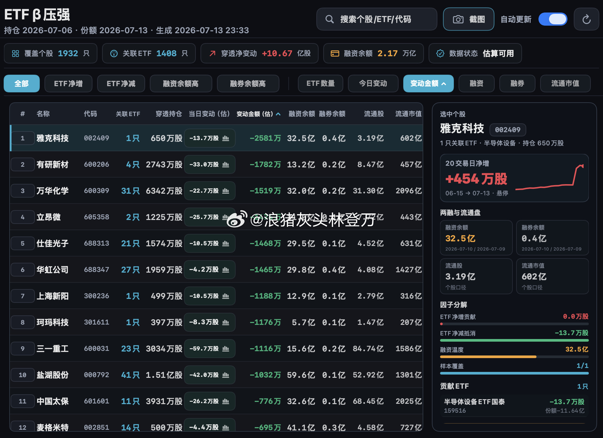

# Flow「ETF β压强」全市场个股穿透工作台实施交接

> 交接对象：GPT-5.6 Luna（或后续实现者）
> 编写日期：2026-08-11
> 仓库：`xiaoker/flow`
> 生产地址：`https://flow.xiaoker.com`
> 文档状态：核心链路已实施，本文仍是产品、数据、工程和 QA 的验收合同；个股行情、流通盘和个股两融保留为经官方字段验证后的可选增强

## 0. 必须先读的结论

本任务不是继续优化现有“单只个股详情页”，而是新增一个独立的 **全市场个股穿透工作台**。目标参考图为：



正式页面必须包含：

1. 全市场摘要：覆盖个股、关联 ETF、ETF 篮子等价净变化、市场融资余额、数据状态。
2. 个股横截面：搜索、筛选、排序、分页和高密度表格。
3. 选中个股侧栏：20 个交易日变化、两融与流通盘、正负 ETF 贡献分解、贡献 ETF 列表。
4. 稳定 URL：可直接打开工作台，也可把选中个股写入 URL。
5. 同一发布版本：页面、摘要、表格、个股侧栏和日期必须来自同一个已通过 QA 的 release。

现有功能只完成了“全局搜索 + ETF 下钻 + 单只个股详情”。它是本页面的基础能力，不是本任务的最终结果。

本文明确覆盖并替代以下旧范围决策：

- `docs/audits/2026-07-16-flow-reverse-engineering/audit.md` 中“持仓穿透明确排除”的结论。
- `docs/trading-desk-plan.md` 中“ETF β压强仍不做”的结论。

本文不替代以下合同：

- `docs/data-quality-contract.md`
- `docs/flow-runtime-architecture.md`
- `docs/data-lineage-manual-checklist.md`

任何实现不得为了接近参考图而伪造截图中的数字、日期或“真实资金流”结论。

---

## 1. 产品定义与真值边界

### 1.1 页面名称

导航和页面标题使用：

```text
ETF β压强
```

标题下必须长期显示口径说明：

```text
ETF 份额变化 × 官方 PCF 申赎篮子的个股等价变化估算；不是二级市场真实资金流，也不是基金实际持仓变动。
```

“β压强”只是产品名称，不是已被交易所披露的官方指标。

### 1.2 页面允许表达什么

允许：

- ETF 篮子映射量（估）
- 当日篮子等价变化（估）
- 正向 ETF 贡献
- 负向 ETF 抵消
- 估算金额
- 官方融资余额、融券余量或融券余量金额
- 覆盖 ETF 数、覆盖个股数、日期与数据缺口

禁止：

- 个股真实资金净流入
- 主力资金流入
- 国家队买入或卖出
- ETF 实际持仓增加
- 北向资金流入该股
- 缺失价格、两融或历史数据时用 0 替代

### 1.3 参考图与正式产品的差异

视觉结构参考截图，但下列文案必须更准确：

| 参考图文案 | 正式页面文案 | 原因 |
| --- | --- | --- |
| 穿透持仓 | ETF 篮子映射量（估） | PCF 是申赎清单，不等于基金实际持仓 |
| 今日变动（估） | 当日篮子等价变化（估） | 明确计算对象与估算属性 |
| 变动金额（估） | 估算金额 | 只有同日收盘价可用时才显示 |
| 融资温度 | 融资余额变化 / 历史分位 | 不制造不可复算的情绪分数 |
| 持仓日期 | PCF 有效日 / PCF 发布日 | 同时保留业务日和实际披露日 |

---

## 2. 开始前的仓库基线

实施前运行：

```bash
git status --short
git branch --show-current
git log -5 --oneline
```

本文编写时：

```text
branch: main
HEAD: be942a0 fix: keep stock search compatible with radar releases
```

工作树已有与本任务无关的用户改动：

```text
M  reports/phase0/latest-manifest.json
M  reports/phase0/latest-quality-summary.json
M  reports/phase0/latest-release-qa.json
?? memory/
```

不得覆盖、还原、暂存或提交这些文件。

实施者必须先阅读：

- `docs/handoff/stock-detail-search.md`
- `docs/flow-runtime-architecture.md`
- `docs/data-quality-contract.md`
- `src/trading_desk/etf_stock_flow.py`
- `src/trading_desk/read_models.py`
- `web/app/stock-detail-view.tsx`
- `web/app/dashboard-bootstrap.tsx`
- `web/app/dashboard.tsx`
- `web/app/lib/release-store.ts`
- `.github/workflows/daily-data.yml`

---

## 3. 当前已经具备什么

| 现有能力 | 位置 | 本任务如何复用 |
| --- | --- | --- |
| ETF 份额与 PCF 的日期安全计算 | `src/trading_desk/etf_stock_flow.py` | 保留现有公式和日期门禁，扩展全量个股聚合字段 |
| 完整个股目录 | `stock-flow-catalog.json` | 作为全市场表格的计算输入，不从 Radar Top 500 反推 |
| 个股搜索索引 | `stock_search.json` | 继续供全局搜索使用，不塞入宽表指标 |
| 8 个确定性个股分片 | `stock_0.json` 至 `stock_7.json` | 继续承载选中个股详情，并增加历史与可选两融字段 |
| 单只个股详情页 | `web/app/stock-detail-view.tsx` | 复用类型、贡献 ETF 和口径组件，避免第二套计算逻辑 |
| 不可变 R2 发布与 D1 活跃指针 | `read_models.py`、`release-store.ts` | 新页面必须进入同一 release manifest |
| Worker 流式返回 | `/api/v2/views/[view]`、`/api/v2/stocks/[shard]` | Worker 不解析全市场 JSON，不现场聚合 |
| 市场级融资融券历史 | `marginSeries` / `margin_daily` | 只用于顶部市场总额，不得冒充个股两融 |

现有个股计算：

```text
个股当日篮子等价变化股数
= ETF 当日份额变化 ÷ ETF 最小申赎单位 × PCF 成分数量
```

现有代码还没有安全提供：

- 全市场工作台页面和导航。
- 个股级“ETF 篮子映射量（估）”汇总字段。
- 20 个交易日个股穿透历史。
- 个股同日收盘价和估算金额。
- 个股融资融券明细。
- 流通股本与流通市值。

---

## 4. 指标与公式合同

### 4.1 个股唯一键

```text
stock_key = listing_market + ":" + stock_code
```

不得按股票名称关联，也不得把贡献 ETF 的市场当成个股上市市场。

关联 ETF 唯一键必须是：

```text
etf_key = etf_market + ":" + etf_code
```

计算 ETF 数量时不得只对 `etf_code` 去重。

工作台的“覆盖个股”只统计可以由官方字段确认是股票的成分证券。规范化 PCF 应保留官方证券类别；现金、债券、基金、存托凭证和类别待核验行不能混入个股数量。若源文件没有证券类别，必须通过可追溯的官方证券主数据确认；不能只凭代码前缀把所有成分猜成股票。

### 4.2 ETF 篮子映射量（估）

对于个股 `s`、交易日 `t`：

```text
penetrated_shares[s,t]
= Σ_e (
    etf_total_shares[e,t]
    ÷ creation_unit[e,t]
    × pcf_quantity[e,s,t]
  )
```

该值表示按 ETF 总份额和官方 PCF 清单映射出的理论成分数量，不是基金正式持仓。

当前代码已经计算每个贡献 ETF 的 `currentPenetratedShares`，但个股目录只保留前 8 个贡献 ETF。正式的 `penetratedShares` 必须在截断贡献列表之前，对该个股全部匹配 ETF 求和，不能从前 8 项反推。

### 4.3 当日篮子等价变化（估）

```text
net_shares[s,t]
= Σ_e (
    (etf_total_shares[e,t] - etf_total_shares[e,t-1])
    ÷ creation_unit[e,t]
    × pcf_quantity[e,s,t]
  )
```

同时保留：

```text
gross_inflow_shares  = Σ max(contribution, 0)
gross_outflow_shares = Σ abs(min(contribution, 0))
net_shares           = gross_inflow_shares - gross_outflow_shares
```

页面不能只显示净值而隐藏正负抵消。

### 4.4 估算金额

只有存在同一 `stock_key + trade_date` 的可信收盘价时才计算：

```text
estimated_amount_yuan[s,t]
= net_shares[s,t] × close_price_yuan[s,t]
```

显示单位：亿元。

```text
estimated_amount_100m = estimated_amount_yuan ÷ 100_000_000
```

价格日期不一致、停牌无当日收盘价、来源未通过 QA 时：

```text
estimatedAmountYuan = null
```

不得使用最新价、前收盘价或 ETF NAV 替代同日个股收盘价。页面显示“价格覆盖不足”，排序时把 `null` 放到最后。

`stock_market_daily` 必须带 `currency`。第一版只有人民币报价证券可以进入跨股票可比较的“估算金额（亿元）”；港币或其他币种没有同日可信汇率时保留原币价格，但 `estimatedAmountYuan=null`。

### 4.5 20 个交易日净变化

```text
rolling_20d_net_shares[s,t] = Σ net_shares[s,d]
```

其中 `d` 为截至 `t` 的最近 20 个连续已发布交易日。必须满足 20/20 个节点；缺一个就返回 `null`。

侧栏折线使用累计路径，起点为 0：

```text
cumulative[0] = 0
cumulative[i] = cumulative[i-1] + net_shares[date_i]
```

若当前只有 2–19 个连续节点，可以画“历史积累中”折线，但不得把标题写成“20 日净增”；必须显示实际覆盖 `N/20`。

### 4.6 个股融资融券

允许展示的官方字段：

- 融资余额（元）
- 融资买入额（元）
- 融资余额日变化（元）
- 融券余量（股/份/手，保留原始单位）
- 融券余量金额（元，来源有该字段时）
- 融券卖出量
- 融资融券余额（元）

```text
financing_balance_change_yuan
= financing_balance_yuan[t] - financing_balance_yuan[t-1]
```

“融资升温”筛选定义为：

```text
financing_balance_change_yuan > 0
```

“融券升温”筛选定义为：

```text
lending_balance_value_change_yuan > 0
```

若只有融券余量、没有官方余量金额，不得擅自用不同日期价格换算。

上交所公开页面说明单只证券明细包含融资余额、融资买入额、融券余量、融券余量金额等字段：

- <https://www.sse.com.cn/market/othersdata/margin/detail/index.shtml>

深交所说明每个交易日开市前发布前一交易日单只标的证券融资融券信息：

- <https://investor.szse.cn/knowledge/stock/margin/t20190724_568897.html>
- <https://www.szse.cn/www/marketServices/deal/finance/>

北交所入口：

- <https://www.bse.cn/disclosure/rzrq_disclosure.html>

实现者必须从官方页面实际网络请求反查并固定下载接口、请求参数、字段和日期语义，增加 fixture 与映射测试。不要仅抓取渲染后的页面文字。

### 4.7 流通股本与流通市值

只有存在官方、可追溯且同日有效的流通股本时才展示：

```text
float_market_cap_yuan = float_shares × close_price_yuan
```

若只能取得总股本，不得标为流通股本。若没有可靠免费源，这两列保留但显示 `—` 和覆盖提示，不得阻塞 ETF 穿透核心页面发布。

### 4.8 个股样本覆盖率

```text
stock_etf_coverage
= matched_etf_count_for_stock ÷ aligned_pcf_etf_count_for_stock
```

- 分母：同一有效 PCF 中包含该个股的 ETF 数。
- 分子：同时具备 `t` 与 `t-1` 官方份额、可参与计算的 ETF 数。
- UI 显示 `matched/aligned`，例如 `147/150`。
- 分母为 0 时返回 `null`，不得显示 0%。

### 4.9 名称冲突

同一 `stock_key` 在多个官方 PCF 中出现不同非空名称时，发布前必须：

1. 规范空格、全半角和大小写后再比较。
2. 仍冲突则生成 QA finding，保留所有原始值。
3. 不能静默取第一行名称。
4. 页面在冲突未解决时使用代码并显示“名称待核验”。

---

## 5. 日期合同

### 5.1 发布日期

页面 `asOf` 必须是 ETF 份额变化对应的交易日：

```text
shareDate = asOf
```

PCF 仅允许：

1. `pcfDate == shareDate`；`same_trading_day`。
2. `pcfDate > shareDate` 且官方 `PRE_TRADING_DAY == shareDate`；`next_day_previous_trade_date`。

其他情况整份 ETF→个股模型不可用，不得回退到最近 PCF。

### 5.2 多源同日原则

| 数据 | 必须匹配的日期 | 缺失处理 |
| --- | --- | --- |
| ETF 份额 | `asOf` 和紧邻前一交易日 | 核心模型不可发布 |
| PCF | 对齐到 `asOf` | 核心模型不可发布 |
| 个股收盘价 | `asOf` | 金额为 `null`，股数仍可发布 |
| 个股两融 | `asOf` | 两融字段为 `null`，不得回填其他日期 |
| 流通股本 | 在 `asOf` 有效 | 流通盘字段为 `null` |

顶部必须分别显示：

- ETF 份额日
- 前一可比份额日
- PCF 有效日
- PCF 发布日
- 个股价格覆盖日
- 个股两融覆盖日
- 页面生成时间

不得只显示一个模糊的“数据截至”。

### 5.3 历史页面

推荐 URL：

```text
/?view=pressure
/?view=pressure&date=2026-08-10
/?view=pressure&date=2026-08-10&venue=SSE&code=600522
```

指定历史日期时，只能读取该日 immutable release 中的 `pressure` 和对应 `stock_N`。该日没有 `pressure` 工件时显示：

```text
该交易日尚未发布 ETF β压强工作台
```

不得用最新数据覆盖历史 URL。

---

## 6. 目标发布架构

### 6.1 不改变总体架构

```text
交易所官方来源
  → GitHub Actions 采集、规范化、QA
  → Python 离线计算 ETF→个股与历史状态
  → 生成 bounded read models
  → R2 immutable objects
  → D1 release_manifest / active_release 原子切换
  → Worker 只查指针并流式返回
  → 浏览器筛选、排序、分页和渲染
```

禁止：

- Worker 请求中读取全量 ETF rolling state。
- Worker 请求中解析 PCF 或聚合几千只个股。
- Worker 请求中遍历 8 个 stock shard 拼全市场表格。
- 页面加载时一次下载所有个股详情分片。
- 为该页面新增付费数据库、队列或常驻服务器。

### 6.2 工件设计

当前 release 有 18 个工件：

```text
9 个核心视图（含按需读取的 `radar_flow`）
+ stock_search
+ stock_0 ... stock_7
= 18
```

本任务只新增 1 个全市场紧凑工件：

```text
pressure.json
```

总数仍低于 `MAX_ARTIFACTS=20`，不会增加 ETF 详情分片。

不要新增另一组 `pressure_0..7`。选中个股详情继续复用 `stock_0..7`。

### 6.3 `pressure.json` 建议合同

```json
{
  "schemaVersion": 1,
  "asOf": "2026-08-10",
  "basis": {
    "shareDate": "2026-08-10",
    "previousShareDate": "2026-08-07",
    "pcfEffectiveDate": "2026-08-10",
    "pcfPublishedDate": "2026-08-11",
    "pcfAlignment": "next_day_previous_trade_date",
    "calculationVersion": "etf-stock-pressure-v1"
  },
  "coverage": {
    "stockCount": 1932,
    "matchedEtfCount": 1390,
    "priceStockCount": 0,
    "marginStockCount": 0,
    "floatStockCount": 0,
    "history20StockCount": 0
  },
  "summary": {
    "netShares": 909000000,
    "grossInflowShares": 1200000000,
    "grossOutflowShares": 291000000,
    "marketFinancingBalanceYuan": 2240000000000
  },
  "rows": [
    {
      "listingMarket": "101",
      "listingMarketName": "上交所",
      "securityType": "stock",
      "code": "600522",
      "name": "中天科技",
      "shard": "stock_3",
      "etfCount": 18,
      "penetratedShares": 100000000,
      "netShares": 500000,
      "grossInflowShares": 800000,
      "grossOutflowShares": 300000,
      "rolling20dNetShares": null,
      "historyCoverage": 3,
      "closePriceYuan": null,
      "currency": "CNY",
      "estimatedAmountYuan": null,
      "financingBalanceYuan": null,
      "financingBalanceChangeYuan": null,
      "lendingBalanceValueYuan": null,
      "lendingBalanceValueChangeYuan": null,
      "floatShares": null,
      "floatMarketCapYuan": null,
      "matchedEtfCount": 18,
      "alignedPcfEtfCount": 20
    }
  ],
  "warnings": []
}
```

示例数字只说明字段形状，测试和生产不得写死。

`pressure.json` 不包含：

- 贡献 ETF 明细。
- 20 日完整折线数组。
- 原始 PCF 行。
- 大段口径文字。

这些内容分别留在个股分片或页面静态文案中。

### 6.4 个股分片扩展

现有 `stock_N.items[]` 增加：

```json
{
  "penetratedShares": 100000000,
  "matchedEtfCount": 18,
  "alignedPcfEtfCount": 20,
  "history": [
    {
      "date": "2026-08-10",
      "netShares": 500000,
      "penetratedShares": 100000000,
      "estimatedAmountYuan": null,
      "financingBalanceYuan": null,
      "financingBalanceChangeYuan": null
    }
  ],
  "marketData": {
    "date": "2026-08-10",
    "closePriceYuan": null,
    "floatShares": null,
    "floatMarketCapYuan": null
  },
  "margin": {
    "date": "2026-08-10",
    "financingBalanceYuan": null,
    "financingBalanceChangeYuan": null,
    "lendingBalanceQuantity": null,
    "lendingQuantityUnit": null,
    "lendingBalanceValueYuan": null,
    "lendingBalanceValueChangeYuan": null
  }
}
```

`contributors` 仍只保留按绝对贡献排序的前 N 项，但 `penetratedShares`、正负合计、覆盖率和全市场 summary 必须来自未截断全集。

### 6.5 复用上一份已激活个股分片维护历史

不要再创建一套长期累积的全市场 pressure state。每天构建时，通过现有只读接口下载 **上一份已激活 release** 的 8 个 `stock_N`，验证 8 个响应的 `X-Flow-Release-Id` 和 `asOf` 完全一致，再把每只个股的历史带入当日构建。

每个 `stock_key` 最多保留 21 个真实发布节点：

```text
date
netShares
penetratedShares
estimatedAmountYuan | null
financingBalanceYuan | null
financingBalanceChangeYuan | null
```

不得在历史数组中重复保存贡献 ETF 明细或 PCF 原文。原始证据继续保存在 R2 raw/normalized 层；历史数组随每日 immutable `stock_N` 工件发布。

流程：

```text
GitHub Actions
  ├─ 获取上一份 active release 的 stock_0..7
  ├─ 校验 8 个分片属于同一 release
  ├─ 按 stock_key 读取上一版 history
  ├─ 用当日 verified catalog 追加/替换 asOf 节点
  ├─ 截断为最近 21 个真实发布节点
  ├─ 生成 pressure + enriched stock shards
  └─ 与其他 read models 一起原子发布
```

同一 `stock_key + date` 重跑必须覆盖成相同结果，不能重复追加。

迁移规则：

- 上一份 release 尚未包含 `pressure` 或 `history` 时，允许从 1 个节点开始积累。
- 上一份 release 已声明支持 `pressure`，但 8 个分片未全部成功读取或 release ID 不一致时，本次构建失败并保留上一份 active release；不得把所有股票的历史静默重置为 1 日。
- 某只股票不在上一日当前覆盖范围、今天重新出现时，从今天重新积累并显示实际覆盖。

### 6.6 免费额度与 Worker 预算

继续使用 Cloudflare Standard R2。当前官方免费层包含 10 GB-month、每月 100 万次 Class A、1000 万次 Class B；Workers Free 每日 10 万请求、单次 HTTP 请求 CPU 10 ms。实现不得靠提升付费档位解决性能问题。

必须保留并增加以下预算门禁：

```text
单个未压缩 read model < 5,000,000 bytes
单个 gzip + base64 上传请求 < 1,500,000 bytes
release artifact count <= 20
浏览器打开 pressure 页面：1 个 pressure 请求 + 1 个轻量日期索引请求
选中个股：最多再请求 1 个 stock shard
Worker：只做 1 次 manifest 指针读取 + 1 次 R2 Get + body streaming
```

CI 必须输出：

- 每个工件原始字节数。
- gzip 字节数和 base64 后请求体估算。
- 本次 release 总字节数。
- 按 22 个交易日估算的月新增 R2 字节数。
- 当前可观测 R2 存储若超过免费层 80%，发出告警但不得自动删除原始数据。

原始数据和已激活 immutable release 不设置自动删除生命周期。若未来接近免费存储上限，必须先给用户一份存储明细与迁移方案，由用户决定是否归档。

---

## 7. 采集与规范层新增

### 7.1 个股两融数据

新增规范数据集：

```text
margin_security_daily
```

最小字段：

```text
trade_date
market
instrument_code
instrument_name
financing_balance_yuan
financing_buy_yuan
securities_lending_balance_quantity
securities_lending_quantity_unit
securities_lending_balance_yuan | null
securities_lending_sell_quantity
margin_total_balance_yuan | null
source_id
source_url
observed_at
raw_sha256
```

规则：

- 市场枚举分别保存 `SSE / SZSE / BSE`，不得把北交所混入深市。
- 同日同市场同代码唯一。
- 金额统一为元；数量保留原始单位字段。
- 名称和代码来自原始数据，不用 ETF PCF 名称覆盖两融原名。
- 当交易所只发布当前标的证券明细时，缺失不能解释为余额为 0。
- 市场级顶部总额继续读取现有官方汇总，不从当前个股明细重新求和。

### 7.2 个股日行情和流通盘

建议新增规范数据集：

```text
stock_market_daily
```

最小字段：

```text
trade_date
market
instrument_code
instrument_name
close_price
currency
close_price_yuan | null
float_shares | null
total_shares | null
source_id
source_url
observed_at
raw_sha256
```

实现前必须先证明下载接口是公开、免费、稳定且可重放的官方数据源。公开页面入口可作为人工核验起点：

- 深交所行情：<https://www.szse.cn/www/market/trend/index.html>
- 上交所股票数据：<https://www.sse.com.cn/market/stockdata/overview/day/>
- 北交所股票行情：<https://www.bse.cn/static/statisticdata.html>

若官方免费接口不能批量稳定获取：

1. 先交付股数口径的完整工作台。
2. 金额、流通股本和流通市值显示 `—` 与覆盖说明。
3. 不得静默改用东方财富、腾讯或其他第三方价格。
4. 若要接入第三方，必须另开决策并增加来源标签与交叉核验，不属于本文默认授权。

### 7.3 原始证据保存

每次采集继续保存：

```text
官方 URL
请求参数
HTTP 状态
响应原文
observed_at
SHA-256
规范化 CSV
字段与日期语义
```

个股两融和日行情只在 GitHub Actions 中解析。不要把几千行 CSV 交给 Worker 请求路径实时处理。

---

## 8. 页面与交互合同

### 8.1 路由和导航

新增 view：

```text
pressure
```

需要修改 `DeskView`、`requestedView()`、主导航、视图加载白名单和 read-model 白名单。

导航显示：

```text
ETF β压强
```

旧 release 没有 `pressure` 工件时，页面显示“当前发布版本尚未包含 ETF β压强”，不能白屏或退回 Overview。

### 8.2 页面布局

桌面端：

```text
┌──────────────────────────────────────────────────────────────────┐
│ 标题 / 日期证据 / 全局搜索 / 刷新                               │
├────────────┬────────────┬────────────┬────────────┬─────────────┤
│ 覆盖个股   │ 关联 ETF   │ 等价净变化 │ 市场融资额 │ 数据状态    │
├──────────────────────────────────────────────────────────────────┤
│ 方向筛选       │ 排序字段                           │ 当前排序   │
├───────────────────────────────────────┬──────────────────────────┤
│ 全市场个股表格（约 70%）              │ 选中个股详情（约 30%）    │
│ 搜索 / sticky header / 分页            │ 20日曲线 / 两融 / 贡献分解 │
└───────────────────────────────────────┴──────────────────────────┘
```

移动端：

```text
摘要卡片
→ 搜索和筛选
→ 个股列表卡片
→ 点击进入独立 stock detail 页
```

移动端不强行压缩整张宽表。

### 8.3 顶部摘要

| 卡片 | 数据来源 | 规则 |
| --- | --- | --- |
| 覆盖个股 | `pressure.coverage.stockCount` | 只计可识别 `stock_key` |
| 关联 ETF | `pressure.coverage.matchedEtfCount` | 对 `etf_market + code` 去重 |
| ETF 篮子等价净变化 | `pressure.summary.netShares` | 同时提供正向与负向 tooltip |
| 市场融资余额 | 现有市场级官方汇总 | 与 `asOf` 同日，否则不可用 |
| 数据状态 | coverage + quality | 显示股数、价格、两融、20日覆盖 |

`marketFinancingBalanceYuan` 必须从规范层“元”字段生成。现有 UI 的 `marginSeries.balance` 使用展示单位，不能在没有显式换算和测试的情况下直接复制进 pressure read model。

### 8.4 筛选

第一版必须有：

```text
全部
ETF 净增       netShares > 0
ETF 净减       netShares < 0
融资升温       financingBalanceChangeYuan > 0
融券升温       lendingBalanceValueChangeYuan > 0
```

同时支持名称或代码搜索。搜索和筛选可组合，切换筛选不清空搜索。

### 8.5 排序

第一版排序字段：

```text
关联 ETF 数
ETF 篮子映射量（估）
当日变化（估）
20 日变化（估）
估算金额
融资余额
融资余额变化
融券余量金额
流通市值
```

规则：

- 正序/倒序可切换。
- `null` 始终排在末尾。
- 相同值按 `listingMarket + code` 稳定排序。
- 默认按 `abs(estimatedAmountYuan)` 倒序；金额覆盖不足时改用 `abs(netShares)`。
- UI 必须明确显示当前排序字段和方向。

### 8.6 表格

建议列：

```text
#
名称
代码
关联 ETF
篮子映射量（估）
当日变化（估）
20 日变化（估）
估算金额
融资余额
融资变化
融券余量金额
流通股
流通市值
```

要求：

- sticky header。
- 每页 50 行，切换 50/100；不要一次渲染几千行 DOM。
- 选中行高亮，但不能只用颜色表示。
- 正数同时带 `+`，负数同时带 `−`。
- 数值单元格 tooltip 显示原始单位、日期和口径。
- 缺失显示 `—`，不显示 `0`。
- 点击行更新右侧详情和 URL；双击或“打开详情”进入现有 `view=stock` 页面。

### 8.7 个股侧栏

顶部：

```text
股票名称 / 代码 / 上市市场
关联 ETF 数 / 分类（若已有可信分类）/ ETF 篮子映射量（估）
```

20 日区域：

- 大数字显示 `rolling20dNetShares`。
- 折线显示累计路径。
- 标记数据起止日和覆盖 `N/20`。
- 少于 2 个节点不画线，显示“历史节点积累中”。

两融与流通盘：

- 融资余额、融资余额变化。
- 融券余量或余量金额，必须带单位。
- 流通股、流通市值。
- 每项显示数据日期；缺失显示覆盖原因。

因子分解：

```text
正向 ETF 贡献  = grossInflowShares
负向 ETF 抵消  = grossOutflowShares
融资余额变化   = financingBalanceChangeYuan | null
样本覆盖       = matchedEtfCount / alignedPcfEtfCount
```

贡献 ETF：

- ETF 简称、代码、市场。
- ETF 份额变化。
- 对该个股的等价变化股数。
- 当前篮子映射量（估）。
- 现金替代标记。
- 默认显示前 8 个；如果被截断，明确显示 `已展示 8/N`。

### 8.8 加载和错误状态

必须分别处理：

| 状态 | 用户看到什么 |
| --- | --- |
| `pressure` 未发布 | 当前版本尚未包含该工作台 |
| 核心 ETF/PCF 不可用 | 明确列出日期或来源失败，不显示排行榜 |
| 价格缺失 | 股数正常，金额列为 `—` |
| 个股两融缺失 | 两融字段为 `—`，顶部市场总额仍可显示 |
| 20 日不足 | 显示实际覆盖 `N/20` |
| 选中个股 shard 失败 | 表格保留，侧栏可重试 |
| release 切换中 | 保留上一份完整页面，不混合两个 release |
| 网络超时 | 显示重试，不清空已加载数据 |

---

## 9. 代码修改建议

### 9.1 Python / 数据层

| 文件 | 修改 |
| --- | --- |
| `src/trading_desk/etf_stock_flow.py` | 增加完整 `penetratedShares`、逐股覆盖分母、ETF pair 去重、名称冲突检查 |
| `src/trading_desk/read_models.py` | 增加 `pressure` view；扩展 stock shard；保持确定性、有限大小 |
| `src/trading_desk/ingest_bundle.py` | read-model 名称白名单增加 `pressure` |
| `src/trading_desk/quality.py` | 新增个股两融/行情字段、日期、单位和唯一性门禁 |
| `src/trading_desk/phase0.py` | 在现有窗口中采集可用的官方个股两融/行情；失败按核心/可选来源分级 |
| `src/trading_desk/adapters/official.py` | 保留 PCF 官方证券类别，并增加经验证的个股两融/行情适配器 |
| `src/trading_desk/history_bundle.py` | 归档新增原始/规范数据；宽文件必须分块，不能让 Worker 解析全市场 CSV |
| 新建 `src/trading_desk/stock_pressure_state.py` | 纯函数合并上一 release 分片与当日目录，保留 21 个节点并计算 20 日完整性 |
| `scripts/build_read_models.py` | 接收已合并历史的 pressure catalog，以及可选两融与行情输入 |
| 新建 `scripts/build_stock_pressure_state.py` | 拉取上一 active release 的 8 个分片、校验 release、追加当日并输出读模型输入 |
| `.github/workflows/daily-data.yml` | 在 confirmed snapshot 后合并历史并构建 pressure；发布前执行 QA |

不要让 `read_models.py` 自己联网。所有输入必须是已验证的本地文件或显式传入的 JSON。

### 9.2 Worker / 发布层

| 文件 | 修改 |
| --- | --- |
| `web/app/api/v2/views/[view]/route.ts` | `ALLOWED_VIEWS` 增加 `pressure` |
| `web/app/api/v1/admin/read-model-import/route.ts` | 名称白名单增加 `pressure`；保留体积与工件数限制 |
| `web/app/api/v1/admin/import/route.ts` | read-model 白名单增加 `pressure` |
| `web/app/api/v1/admin/history-import/route.ts` | 仅在体积和 CPU 预算内允许新增数据集归档；不得把全市场个股明细逐行写入 D1 |

所有路由在 requested date 缺工件时 fail closed，不能回退最新。

### 9.3 前端

| 文件 | 修改 |
| --- | --- |
| 新建 `web/app/stock-pressure-view.tsx` | 工作台主页面 |
| `web/app/dashboard-bootstrap.tsx` | 增加 `pressure` view 和同 release 加载 |
| `web/app/dashboard.tsx` | 导航、进入工作台、统一搜索联动 |
| `web/app/stock-detail-view.tsx` | 复用/扩展历史、两融和贡献组件；不要重复公式 |
| `web/app/globals.css` | 桌面 split layout、表格、侧栏、移动端 |

优先抽出可复用的纯展示组件和格式函数，但不要为一次性卡片建立复杂组件框架。

---

## 10. 数据流与失败路径

```text
[官方 ETF 份额 t,t-1] ─┐
[官方 PCF + 日期语义] ──┼─> etf_stock_flow.py
                         │      ├─ 日期不匹配 ─> 核心模型 unavailable ─> 不发布排行榜
                         │      ├─ 代码/名称冲突 ─> QA finding
                         │      └─ 完整个股当日聚合
                         │
[官方个股收盘价 t] ──────┤      ├─ 缺失 ─> amount=null
[官方个股两融 t,t-1] ────┤      ├─ 缺失 ─> margin=null
[有效流通股本] ──────────┘      └─ 缺失 ─> float=null
                                │
[上一 active release 的 8 个个股分片]
                                ├─ release/asOf 全部一致？
                                │      ├─ 否 ─> 构建失败，保留旧 release
                                │      └─ 是
                                │
                                ├──────┼─> stock_pressure_state.py
                                │      ├─ 同日重跑 ─> 幂等替换
                                │      ├─ 历史缺口 ─> rolling20=null
                                │      └─ 截断 21 个节点
                                │
                                ├─> pressure.json（全市场紧凑表）
                                └─> stock_0..7（详情 + 历史）
                                             │
                                      发布前交叉对账
                                             │
                                  R2 objects 全部到齐？
                                   ├─ 否 ─> 不切 active_release
                                   └─ 是 ─> D1 原子切指针
                                             │
                                      Worker 流式返回
                                             │
                                  浏览器筛选/排序/分页
```

---

## 11. QA 与自动测试合同

### 11.1 Python 单元测试

扩展 `tests/unit/test_etf_stock_flow.py`：

1. 一个 ETF 净增，独立手算 `penetratedShares` 与 `netShares`。
2. 两个 ETF 对同一股票一增一减，验证 gross 与 net。
3. 同代码不同上市市场不合并。
4. 同 ETF 代码不同 ETF 市场不错误去重。
5. 贡献 ETF 截断时，完整合计不受截断影响。
6. 同一 `stock_key` 多个名称冲突不能静默取首行。
7. PCF 日期错位返回不可用，不回退。
8. 现金替代只产生估算提示，不被当成真实交收。

新增 `tests/unit/test_stock_pressure_state.py`：

1. 同日重跑幂等替换。
2. 21 个节点截断。
3. 20/20 时生成 rolling20；19/20 时为 `null`。
4. 中间日期缺口时为 `null`。
5. 新上市/退市股票不会污染其他股票历史。
6. 缺失价格和两融保留 `null`。
7. 非有限数、负的非法余额、重复业务键被拒绝。

扩展 `tests/unit/test_read_models.py`：

1. manifest 包含 `pressure` 与 `radar_flow`，总工件数为 18。
2. `pressure` 与 8 个 stock shard 确定性生成。
3. `pressure.rows` 和 `stock_search.items` 的 `stock_key` 集合一致。
4. `pressure.summary.netShares` 等于完整个股 `netShares` 求和。
5. `pressure` 行的 shard 与 `stock_shard_name()` 一致。
6. 每个工件未压缩小于 5 MB。
7. 每个发布请求 gzip+base64 后小于 1.5 MB。
8. `null` 不被序列化为 0，NaN/Infinity 被拒绝。

### 11.2 数据集 QA

必须增加：

```text
唯一性：trade_date + market + instrument_code
日期：源披露日期能准确映射到 trade_date
单位：元、股/份/手显式保存
市场：SSE/SZSE/BSE 分开
代码：市场内规范化，不跨市场猜测
名称：原值留存，冲突可见
总额：市场汇总不要求等于当前标的明细之和
覆盖：缺失为 null，不是 0
```

### 11.3 前端与 Worker 测试

扩展 `web/tests/rendered-html.test.mjs` 或拆成更专门的测试文件：

1. `view=pressure` 可路由且导航存在。
2. Worker 流式返回同一 release 的 `pressure`。
3. `?date=` 读取历史 manifest；缺工件 404/503，不回退最新。
4. 页面包含摘要、筛选、排序、表格和侧栏。
5. 正负号和方向文字存在，不能只依赖红绿。
6. `null` 显示 `—`。
7. 50/100 分页，不渲染全部行。
8. 搜索与筛选组合正确。
9. 排序 `null` 始终在末尾。
10. 点击行更新侧栏与 URL。
11. 个股 shard 失败时表格不消失，侧栏可重试。
12. release ID 不一致时保留上一份完整状态。
13. 页面没有“真实资金流”“主力买入”等禁用文案。

### 11.4 端到端固定样例

使用一个小型 fixture：

```text
ETF A: 份额 +300 万，creation unit 300 万，股票 X 数量 100
ETF B: 份额 -600 万，creation unit 300 万，股票 X 数量 50
```

应得到：

```text
ETF A 贡献 = +100 股
ETF B 贡献 = -100 股
gross inflow = 100 股
gross outflow = 100 股
net = 0 股
```

页面必须显示“正负完全抵消”，不能把净值 0 解释为没有 ETF 活动。

### 11.5 生产冒烟

发布后至少检查：

```bash
curl -I https://flow.xiaoker.com/api/v2/views/pressure
curl https://flow.xiaoker.com/api/v2/releases/latest
curl "https://flow.xiaoker.com/api/v2/views/pressure?date=<asOf>"
curl "https://flow.xiaoker.com/api/v2/stocks/stock_0?date=<asOf>"
```

验证：

- 状态 200。
- `X-Flow-Release-Id` 一致。
- `X-Flow-View: pressure`。
- `asOf` 一致。
- 页面不出现 Error 1102。
- 刷新、切日期、选股和返回均正常。

---

## 12. 现实失败模式

| 失败 | 必须测试 | 系统行为 | 用户可见 |
| --- | --- | --- | --- |
| PCF 与份额日错位 | 是 | 核心模型不可发布 | 明确日期不匹配 |
| 只有当日份额、缺前日 | 是 | 不计算变化 | 覆盖不足 |
| 个股价格缺失 | 是 | 金额 `null` | 价格覆盖不足 |
| 两融发布日期落后 | 是 | 两融 `null` | 显示两融数据日或未发布 |
| 北交所数据混入深市 | 是，回归测试 | 发布阻断 | 数据 QA 失败，不上线 |
| 个股名称冲突 | 是 | 不静默取首行 | 名称待核验 |
| 贡献 ETF 截断 | 是 | 合计用全集 | 显示 `8/N` |
| 上一 release 分片读取中断 | 是 | 构建失败，不切 active release | 旧完整版本继续服务 |
| `pressure` 超过 5 MB | 是 | CI 失败 | 旧 release 继续服务 |
| 上传体超过 1.5 MB | 是 | CI 失败 | 旧 release 继续服务 |
| 18 个工件未全部到齐 | 是 | 不切 active release | 旧 release 继续服务 |
| Worker 请求中解析大 JSON | 静态与生产检查 | 禁止合并 | 避免 1102 |
| 浏览器一次渲染 6000 行 | 前端测试 | 分页 50/100 | 页面保持响应 |

任何“无测试 + 无错误处理 + 用户无提示”的失败路径都视为阻断上线的 critical gap。

---

## 13. 实施顺序与提交建议

### 阶段 A：先锁定数据合同

1. 为本文件中的公式、日期、市场和缺失规则写失败测试。
2. 扩展 ETF→个股纯计算，生成完整聚合字段。
3. 不改 UI，先让 fixture 和交叉对账通过。

### 阶段 B：历史合并与读模型

1. 实现从上一 active release 的 8 个分片合并 21 个历史节点。
2. 生成 `pressure.json` 并扩展现有 stock shard。
3. 增加体积、确定性、同 release 和历史日期测试。
4. 在本地 fixture 上输出工件尺寸报告。

### 阶段 C：发布通道

1. 增加 `pressure` 白名单和 view route。
2. 增加构建脚本对上一 active release 8 个个股分片的校验读取；不新增长期 pressure state 接口。
3. 保证旧 release 缺少 pressure 时有明确状态。
4. 验证不改变现有 Overview/Radar/国家队/南北互通/两融页面。

### 阶段 D：工作台 UI

1. 实现摘要与证据条。
2. 实现搜索、筛选、排序和分页表格。
3. 实现个股侧栏与 20 日曲线。
4. 复用现有独立个股页作为深度详情。
5. 完成桌面与移动端状态。

### 阶段 E：可选官方增强字段

1. 接入并验证个股两融。
2. 接入并验证同日收盘价。
3. 接入可确认的流通股本。
4. 对每一类字段单独显示 coverage；缺失不阻断 ETF 股数核心工作台。

### 阶段 F：发布与验证

1. 全量 Python 测试。
2. `cd web && npm test && npm run lint`。
3. 本地构建 read models，核对尺寸。
4. 推送代码。
5. 运行一次 `daily-data.yml`。
6. 确认 release 包含 18 个工件（`radar_flow` 需与其他核心视图同日、同 releaseId）。
7. 生产冒烟和截图对照验收。

建议分成小提交，不要把数据公式、采集、发布和视觉全部塞进一个不可审查的大提交。

---

## 14. 不在本任务范围内

- 盘中实时 ETF 申赎或个股资金流：当前官方来源和免费架构是日频。
- 推断某个机构、国家队或主力的买卖行为：数据不支持主体归因。
- 主动基金季报持仓穿透：本任务只使用 ETF 官方份额和 PCF。
- 用第三方价格悄悄补齐官方缺口：需要用户另行确认来源合同。
- 交易建议、买卖信号或收益预测：页面只展示可复算事实和估算。
- 为历史缺口补造连续曲线：只从真实、同日、已发布的节点开始积累。
- 新建付费云数据库或常驻计算服务：继续使用现有 GitHub Actions + R2 + D1 + Worker。
- 删除或覆盖历史原始对象来节省空间：原始证据归用户所有，另行决策。

---

## 15. 最终验收清单

只有以下全部满足，才能回复用户“ETF β压强页面已完成”：

### 页面

- [ ] 主导航出现“ETF β压强”。
- [ ] 页面可通过 `/?view=pressure` 直接打开和刷新。
- [ ] 页面结构包含截图中的摘要、筛选、全市场表和右侧个股详情。
- [ ] 表格可搜索、筛选、排序和分页。
- [ ] 点击个股更新侧栏；可继续进入独立个股页。
- [ ] 20 日折线按真实节点和覆盖率显示。
- [ ] 桌面与移动端均可用，文字不挤压。

### 数据

- [ ] 页面日期、ETF 份额日、PCF 日期严格对齐。
- [ ] `pressure` 与 stock shard 属于同一 release ID。
- [ ] 全市场 `netShares` 与现有 ETF→个股全集独立对账一致。
- [ ] 正向贡献、负向抵消和净值满足恒等式。
- [ ] 关联 ETF 按市场+代码去重。
- [ ] 缺价格、两融、流通盘时显示 `—`，不是 0。
- [ ] 截断贡献列表不影响全量合计。
- [ ] 至少抽查 3 只个股，手工从 ETF 份额和 PCF 复算。

### 架构与成本

- [ ] 总工件数 18，不超过 20。
- [ ] 每个 read model < 5 MB。
- [ ] 每个上传请求 < 1.5 MB。
- [ ] Worker 不解析或聚合全市场 read model。
- [ ] 页面初始只下载 pressure 与轻量日期索引；选择个股最多再下载一个 shard。
- [ ] 不出现 Cloudflare Error 1102。
- [ ] 存储增长报告未触及免费层 80% 告警。

### 回归

- [ ] Overview、ETF Radar、板块轮动、国家队、南北互通、融资融券均正常。
- [ ] 现有个股搜索和 `view=stock` 仍正常。
- [ ] 历史日期不会读取最新个股数据。
- [ ] 自动刷新不会清空当前完整页面。
- [ ] 生产发布失败时 active release 保持原值。

---

## 16. 给实施者的最后提醒

这类页面最容易犯的错误，是先把参考图画出来，再寻找可以填进去的数字。正确顺序必须相反：

```text
先锁定官方原始字段
→ 再锁定日期与业务键
→ 再写公式和交叉对账
→ 再生成 bounded read model
→ 最后把已经可信的字段放进页面
```

如果某列暂时没有可信数据，正式结果是 `— + 原因 + 覆盖率`，不是一个看起来合理的数字。
