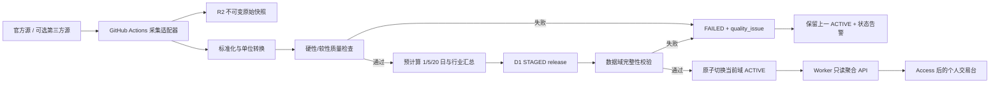

# 个人资金流向交易台规划

日期：2026-07-16

状态：v0.3 实施中：ETF 全量池与分类、互联互通趋势、两融趋势

定位：个人使用、联网访问、日频更新、开源与免费优先

## 1. 产品结论

这不是一个“给出买卖建议”的系统，而是一个可信的资金流向观察台。它每天回答四个问题：

1. 宽基 ETF 正在获得申购还是遭遇赎回？
2. 哪些行业 ETF 的资金流入具有 1 日、5 日、20 日持续性？
3. 互联互通资金当天发生了什么，哪些数据是官方可见的？
4. 融资资金正在扩张还是收缩，主要集中在哪些行业和证券？

第一版优先解决“能看见、看得懂、知道数据是否可信”，不提供交易指令、自动下单或收益预测。

## 2. 已确认前提

- 仅供个人使用，不建设注册、订阅、租户和运营后台。
- 产品需要联网，可通过 GitHub 管理源码并部署到 Cloudflare。
- 第一版接受日频数据，不追求盘中实时。
- 数据必须分为“官方事实、可复算指标、第三方估算”三种可信等级。
- 托管版默认只启用 A/B 级数据；C 级第三方估算作为实验功能默认关闭。
- 技术选型优先开源和免费方案，并保留替换数据源的能力。
- ETF β 压强仍不做；个股持仓穿透已重新纳入，但仅作为 ETF 雷达详情中的 PCF 申赎篮子等价估算（同日或官方 `PRE_TRADING_DAY` 次日对齐），不扩展为独立实时交易信号。

## 3. 数据口径原则

### 3.1 可信等级

| 等级 | 定义 | 示例 | 展示方式 |
|---|---|---|---|
| A 官方事实 | 交易所或指数机构直接发布 | 两融余额、ETF 份额、南向买卖额 | 绿色“官方”标识 |
| B 可复算指标 | 由官方字段按公开公式计算 | ETF 估算净申购、融资余额变化 | 蓝色“计算值”标识并显示公式 |
| C 第三方估算 | 数据商按成交方向或订单规模估算 | 主力净流入、超大单净流入 | 灰色“估算”标识，不能与 A/B 混加 |

任何卡片都必须显示统计日期、抓取时间、来源、口径和数据状态。

C 级数据必须位于独立的“第三方估算”区域并受功能开关控制，不得与 A/B 指标相加、替代或共同生成“总资金流”。其采集失败只记录告警，不阻断 A/B 正式数据版本发布。启用时页面固定提示：该指标是供应商根据成交方向或订单规模形成的估算，不代表 ETF 申赎、账户真实资金或交易所官方净流入。

### 3.2 核心指标公式

#### ETF 估算净申购金额

```text
ETF 估算申赎金额按交易日逐日计算：

`Σ[(当日份额 - 前一交易日份额) × 当日对应官方单位净值]`

结果统一换算为亿元。多日窗口必须先逐日估算再累加，不能用窗口末日净值乘整段份额差。
```

若对应交易日的官方单位净值尚未发布，该 ETF 当日金额保持空值并降低覆盖率；不使用收盘价或最新净值静默替代。净值到达后由下一次采集回补。

#### 融资余额变化

```text
融资余额变化 = 当日融资余额 - 前一交易日融资余额
```

该指标反映融资债务规模变化，应命名为“融资余额变化”，不能直接命名为“融资净流入”。

#### 南向净买入

```text
南向净买入 = 港股通买入成交金额 - 港股通卖出成交金额
```

#### 北向数据限制

自 2024-08-19 起，北向不再公开盘中买入额、卖出额和净流入。第一版只展示官方仍披露的成交总额、成交笔数、ETF 成交额、前十大活跃证券，以及季度持仓。不得生成“实时北向净流入”替代值。

### 3.3 ETF 纳入范围与分类

当前全量池纳入上交所与深交所官方列表中的 ETF。分类的目的是筛选与汇总，不用来隐藏非 A 股产品：

- 宽基 ETF：跟踪综合、市场层级或市值规模指数；
- 行业 ETF：跟踪指数可以映射到唯一的一级或二级行业；
- 策略 ETF：红利、成长、价值、低波等，单独分类；
- 主题 ETF：机器人、低空经济、央企等，单独分类，不强行计入行业；
- 跨境、债券、商品和货币 ETF 保留在全量雷达中，但与 A 股行业/宽基分开统计。

每只 ETF 在任一分类版本中只能有一个主分类。同一指数对应的多只 ETF 均保留，分类汇总时对各基金的份额变化求和。分类优先使用官方投资类型，缺失时才使用基金简称关键词。无法可靠确定主分类的产品进入“其他”，展示明细但不用于主线判断。分类规则使用版本号记录。

## 4. 第一版信息架构

### 4.1 总览页

打开页面后按以下顺序呈现：

1. 数据日期、最近更新时间、完整度和异常提示。
2. 四张市场卡片：宽基 ETF 净申购、行业 ETF 净申购、南向净买入、融资余额变化。
3. 资金方向热力图：行业 × 1 日/5 日/20 日。
4. 资金持续性榜单：连续流入、由负转正、流入衰减、连续流出。
5. 数据源状态栏：每类数据是否已更新、是否使用降级源。

### 4.2 ETF 雷达

分为“宽基”和“行业”两个标签页。

每只 ETF 展示：

- 1 日、5 日、20 日估算净申购金额；
- 基金份额及份额变化率；
- 成交额、换手率、涨跌幅；
- 最新规模；
- 跟踪指数、分类、基金管理人；
- 数据可信等级和更新时间。

支持按净申购、持续性、成交额和规模排序，并可查看单只 ETF 的历史曲线。

### 4.3 互联互通

北向模块：

- 沪股通、深股通成交总额与成交笔数；
- ETF 成交额；
- 前十大成交活跃证券；
- 季度持仓变化；
- 固定提示“北向实时净流入已停止披露”。

南向模块：

- 港股通沪、港股通深买入额、卖出额与净买入；
- 前十大活跃证券；
- 单只证券持股量及日变化；
- 1 日、5 日、20 日累计净买入。

### 4.4 融资融券

- 沪市、深市及合计融资余额；
- 当日融资买入额、融资余额变化；
- 融券余额与融券卖出量；
- 按行业汇总的融资余额变化；
- 个股融资余额增加/减少榜；
- 融资余额变化与行业涨跌幅的对照散点图。

### 4.5 数据说明

独立页面展示所有数据源、字段定义、公式、更新时间、失败记录和已知限制。该页面不是附属文档，而是产品可信度的一部分。

## 5. 推荐技术架构

### 5.1 技术选型

| 层级 | 选择 | 原因 |
|---|---|---|
| Web 前端 | React 19 + TypeScript + vinext | 开源，可与 Worker API 同源部署 |
| 图表 | Apache ECharts | 免费开源，适合热力图、时间序列、Treemap 和排名图 |
| API | Cloudflare Worker + TypeScript | 无服务器运维，直接访问 D1/R2，个人流量可使用免费额度 |
| 结构化数据 | Cloudflare D1 | 保存标准化日频指标，支持日期和分类查询 |
| 原始快照 | Cloudflare R2 | 保存原始响应与 Parquet 快照，用于审计和重算 |
| 数据采集 | Python 3.12 + AKShare + httpx | 国内公开财经数据接口覆盖较全，开发效率高 |
| 计算与校验 | pandas + PyArrow + Pydantic + pytest | 适合日频小数据集，规则明确且容易测试 |
| 调度 | GitHub Actions | 支持 Python、定时运行和手动补跑，代码与流水线统一管理 |
| 部署 | Cloudflare Workers + Static Assets + Wrangler | 一个所有者管理的 Worker 同时承载页面和 API |
| 访问保护 | Cloudflare Access | 自定义域名仅允许项目所有者邮箱访问，GitHub Actions 使用独立 Service Auth 策略 |

第一版不采用 Kubernetes、ClickHouse、Kafka、Redis、微服务或实时流处理。这些组件不能改善当前日频个人场景，只会增加维护成本。

### 5.2 系统关系

```text
上交所 / 深交所 / 港交所 / 国证指数 / 第三方公开页
                         │
                         ▼
             GitHub Actions 定时采集
               Python source adapters
                         │
            ┌────────────┴────────────┐
            ▼                         ▼
      R2 原始快照                 清洗与指标计算
      JSON/Parquet                      │
                                       ▼
                                  D1 标准化表
                                       │
                                       ▼
                              Cloudflare Worker API
                                       │
                                       ▼
                            React + vinext 交易台
                      Cloudflare Worker Static Assets
                                       │
                                       ▼
                              Cloudflare Access
```

设计重点：采集、标准化、指标计算和展示相互隔离。AKShare 只是数据源适配器，不允许它的字段名称直接渗透到数据库和前端。

### 5.3 数据流与故障边界



采集失败、解析失败、校验失败和写入失败都终止在发布指针之前。任何失败均不得修改当前数据域的 `ACTIVE` 版本。

## 6. 数据源策略

### 6.1 来源优先级

1. 交易所官方页面、下载文件或公开接口；
2. AKShare 对官方公开接口的封装；
3. 可交叉验证的第三方公开接口；
4. 手工导入 CSV 作为紧急补录。

每类数据至少实现主来源和降级来源。主来源失败时允许展示旧数据，但不得把旧数据标记为最新。

### 6.2 第一版数据源

| 数据域 | 主来源 | 采集方式 | 更新频率 |
|---|---|---|---|
| 上交所 ETF 份额 | 上交所基金市场 | 官方接口 | 次交易日 09:15 |
| 深交所 ETF 份额 | 深交所基金列表 | 官方列表 JSON 日期 + XLSX | 次交易日 09:15 |
| ETF 单位净值 | 上海证券交易所 ETF 申购赎回清单、深交所基金列表净值字段 | 官方接口/Excel；按公告日与前一交易日净值日校验 | 日频 |
| 行业分类 | 国证行业分类 | 定期下载并版本化 | 月度检查 |
| 沪市两融 | 上交所融资融券 | 官方接口/AKShare | 次交易日开市前 |
| 深市两融 | 深交所融资融券 | 官方接口/AKShare | 次交易日开市前 |
| 沪深港通 | 沪深港交易所 | 官方盘后数据 | 交易日盘后 |
| 第三方资金流估算 | 东方财富/同花顺公开页 | AKShare | 实验功能，默认关闭 |

### 6.3 原始数据留存

每次采集都在 R2 保存不可变快照：

```text
market-data/raw/{source}/{dataset}/{YYYY-MM-DD}/{sha256}.{extension}
```

同时写入哈希、HTTP 状态、抓取时间、源 URL、请求参数和解析结果。R2 key 使用内容 SHA-256，同一原始文件重试不重复占用空间；接口字段变化时可以重放，不必重新依赖历史网页。

### 6.4 历史数据与回填范围

历史数据按查询粒度分层保存：

- 首次上线导入最近 25 个交易日，确保 1 日、5 日和 20 日指标立即可用；
- 上线后按每日不超过约 50,000 行的节奏，把证券级明细补到 60 个交易日；
- 当前免费版在 D1 保留最近 365 天 ETF 规范化日表；体积较大的页面派生快照仅保留 30 天；
- R2 中原始证据、元数据和发布 manifest 同样滚动保留 365 天；
- “尚未回填”和“真实零值”必须使用不同状态表达，API 同时返回 `coverageStart` 与 `coverageEnd`。

正常日更、发布切换和失败重试优先于历史回填；当日预计写入接近免费额度时自动暂停回填。

## 7. D1 数据模型

建议使用以下核心表：

| 表 | 用途 | 主键/索引 |
|---|---|---|
| `dim_instrument` | 股票、ETF、指数基础信息 | `instrument_id`；代码+市场唯一 |
| `dim_industry` | 国证行业分类及版本 | `industry_id`；分类版本索引 |
| `instrument_industry_map` | 证券到行业的生效区间映射 | 证券+开始日期 |
| `dim_source` | 数据源、许可备注、口径和可信等级 | `source_id` |
| `fact_etf_daily` | 份额、净值、规模、估算净申购 | 日期+ETF |
| `fact_connect_daily` | 沪深港通市场级日数据 | 日期+通道 |
| `fact_connect_top_security` | 前十大活跃证券 | 日期+通道+证券 |
| `fact_connect_holding` | 可获得的持仓快照 | 日期+方向+证券 |
| `fact_margin_market_daily` | 沪深市场两融汇总 | 日期+市场 |
| `fact_margin_security_daily` | 单只证券两融明细 | 日期+市场+证券 |
| `fact_vendor_flow_daily` | 第三方估算资金流 | 日期+供应商+对象 |
| `agg_etf_group_daily` | 宽基、行业、策略和主题的日汇总 | 日期+分类版本+分组 |
| `agg_margin_industry_daily` | 行业两融汇总 | 日期+分类版本+行业 |
| `agg_flow_persistence` | 1/5/20 日持续性与拐点 | 日期+数据域+对象 |
| `data_release` | 各数据域的发布版本及当前激活指针 | `release_id`；`domain`+`status`+日期索引 |
| `ingest_run` | 每次采集的状态、时长、版本 | `run_id` |
| `quality_issue` | 数据缺失、异常和降级记录 | 日期+数据集+规则 |

所有事实表保留 `release_id`、`source_id`、`observed_at` 和日期口径。ETF 当前以 `market + trade_date` 作为发布域，同一市场同一日期只有一个 `ACTIVE` release，因此日线可累积、同日补跑又不会把新旧版本混在一起。

聚合表由 GitHub Actions 在发布前计算，不由 Worker 在线扫描事实表生成。核心复合索引以实际查询为准，至少覆盖：

- ETF 明细：`(release_id, instrument_id, trade_date)`；
- 两融明细：`(release_id, trade_date, instrument_id)`；
- ETF 分组：`(release_id, group_type, group_id, trade_date)`；
- 行业两融：`(release_id, industry_id, trade_date)`；
- 发布状态：`(domain, status, trade_date)`。

不为低选择性字段单独建立大量索引。上线前用 D1 查询元数据记录 `rows_read`，确认总览和榜单不会全表扫描。

## 8. API 边界

第一版只暴露面向页面的聚合接口，避免浏览器直接扫描事实表：

```text
GET /api/v1/overview?date=YYYY-MM-DD
GET /api/v1/etf/flows?group=broad|industry&period=1d|5d|20d
GET /api/v1/etf/{code}/history?from=&to=
GET /api/v1/connect/summary?date=
GET /api/v1/connect/top?direction=&date=
GET /api/v1/margin/summary?period=
GET /api/v1/margin/industries?period=
GET /api/v1/data-status
```

API 返回统一信封：

```json
{
  "data": {},
  "asOf": "2026-07-15",
  "updatedAt": "2026-07-15T23:40:00+08:00",
  "releaseId": "etf-20260715-01",
  "coverageStart": "2026-04-20",
  "coverageEnd": "2026-07-15",
  "sourceGrade": "A",
  "isStale": false,
  "warnings": []
}
```

### 8.1 查询与缓存约束

- 汇总、持续性和行业聚合在采集阶段预计算；Worker 只执行参数化、带索引和有限返回行数的查询；
- 榜单默认返回 20 条、最多 50 条；日线区间最多 3 年；超出范围返回 `400`；
- API 不返回浏览器未使用的大字段，所有金额同时返回原始单位和展示单位元数据；
- 响应 ETag 由 `release_id + 查询参数哈希` 生成，使用 `Cache-Control: private, max-age=60, must-revalidate`；
- 不引入 Redis，不为个人数据启用可被公共共享的缓存；
- 分类版本变化时，从 R2 标准化 Parquet 重算聚合表并生成新发布版本，不在请求路径临时修正历史分类。

## 9. 调度与发布流程

### 9.1 GitHub Actions

设置两个入口，并保留 Cloudflare Cron 作为备用触发：

- `schedule`：Cloudflare Cron 在北京时间 18:30（上交所/港交所）、次日 07:45（深交所晨间发布）和 08:45（PCF 归档与完整日期核验）分时运行；GitHub Actions 在 18:45、08:00、08:55 错峰作为故障转移；每个工件独立归档，只有同一交易日全部核心来源确认后才发布，避免把半份数据显示为完整快照；
- `workflow_dispatch`：可传入三个最近交易日手动补跑。

多个窗口重复请求同一组日期是有意设计，所有写入均按日期和来源幂等。历史工件采用“单工件请求 + R2 状态检查点 + finalize 完整性校验”；如果某个源失败或尚未发布，已到达的原始证据仍可复用，后续窗口只补缺失工件。只有同一交易日的全部核心源确认后，才替换线上快照。

### 9.2 数据写入通道

GitHub Actions 通过 Cloudflare Access Service Auth 和独立 Bearer 密钥调用同源管理写入路由：

1. Python 采集任务生成发布包，包含页面快照、原始字节、元数据、SHA-256 和 ETF 规范化行；
2. Worker 重新校验包结构和 SHA-256，原始字节写入私有 R2，规范化记录以 250 行为一批写入 D1 `STAGED` 版本，全部 SQL 参数化；
3. 所有分批写入完成后执行当前数据域的完整性检查；
4. 仅在校验通过时提交最终发布批次，把新版本切为 `ACTIVE`；
5. 任何步骤失败均保留旧 `ACTIVE` 版本，并允许按同一 `release_id` 或新的补跑版本安全重试。

凭证按用途隔离：部署、Access Service Auth 和采集写入密钥分开管理。凭证只保存在 GitHub Secrets，Fork Pull Request 不得获得生产 Secrets。管理路由不向匿名用户开放，也不在 Worker 中解析交易所文件。

### 9.3 数据域级原子发布

ETF 按市场和交易日维护独立的激活版本。每次更新生成唯一 `release_id`，新记录先以 `STAGED` 状态分批写入。完整写入后使用 D1 `batch()` 把同市场同日新版本切换为 `ACTIVE`，并把同日旧版本切换为 `SUPERSEDED`。写入或校验失败时不更新激活指针，页面快照也不发布。

```text
COLLECTING → STAGED → VALIDATED → ACTIVE → SUPERSEDED
     │          │          │
     └──────────┴──────────┴──→ FAILED
```

事实表使用 `release_id` 隔离新旧数据。发布切换只修改同一数据域的少量 `data_release` 状态行，避免让大批事实数据和发布指针处于同一个超大事务中。

总览卡片分别展示各数据域的 `asOf` 和 `updatedAt`。`/api/v1/data-status` 同时返回每个数据域的激活版本，以及 ETF、互联互通和两融均完成的最大日期 `latestCompleteTradeDate`。前端不得用全局日期掩盖不同数据域的实际统计日期。

### 9.4 幂等写入

同一交易日和数据集重复执行时，结果必须一致。D1 使用 `source + trade_date + sha256` 生成 release 主键；R2 原始快照使用 SHA-256 内容寻址。失败任务可安全重跑。

### 9.5 发布

- 生产使用 Cloudflare Worker `flow`，静态资源和 API 同源部署；
- 代码以 GitHub `main` 为唯一生产源；2026-07-22 实测推送后 Cloudflare 未自动产生新部署，当次使用所有者账号的 Wrangler 发布同一提交；Git 自动构建需在 Cloudflare 控制台另行完成并验证；
- 数据更新不触发前端重新构建；
- 数据和部署使用最小权限 Cloudflare API Token。

### 9.6 私有访问与入口收敛

目标安全边界是“默认拒绝、仅本人邮箱可访问”。2026-07-16 已完成自定义域名、邮箱白名单和 GitHub Actions Service Auth 配置；部署配置同时关闭默认入口：

- 自定义域名整体接入 Cloudflare Access，只允许指定邮箱登录；
- Worker 以同源 `/api/*` 路由提供接口，Cloudflare Access 在边缘验证用户会话或 Service Token；Worker 不根据信任可伪造的身份请求头自行放行；
- 设置 `workers_dev = false`，关闭 Worker 的公共 `workers.dev` 入口；
- Worker Preview URL 禁用，或纳入相同的 Access 策略；
- R2 Bucket 不公开，只允许采集任务和 Worker 通过最小权限凭证访问；
- GitHub Actions 分离“部署”“Access 服务身份”和“数据写入”令牌，令牌只保存在 GitHub Secrets，不进入前端构建产物。

页面和 API 必须处于同一 Access 应用和访问策略下。未通过 Access 的请求在到达 Worker 前被拦截；任何未受保护的默认域名都视为阻断上线的问题。

## 10. 数据质量门槛

写入生产表前至少检查：

- 必填字段、类型和单位是否符合 schema；
- 交易日期是否为预期日期；
- 证券代码是否能映射到基础信息；
- 行数较最近 20 日中位数是否突变超过阈值；
- 同一业务主键是否重复；
- ETF 份额、规模、融资余额是否出现不合理负数；
- 聚合值与交易所汇总值的误差是否在容差内；
- 数据是否晚于服务等级目标。

质量规则分为两类：schema/单位/交易日期/重复主键/汇总严重不一致属于硬性规则，失败时阻断发布；净值暂未发布、行业映射缺失等属于软性规则，允许使用明确的降级状态发布并写入 `warnings`。严重异常时不覆盖上一版有效数据，页面显示“数据待更新”并记录 `quality_issue`。

## 11. 失败与降级策略

| 故障 | 用户看到什么 | 系统处理 |
|---|---|---|
| 官方接口超时 | 上次有效数据和“已过期”提示 | 重试三次，切换降级源 |
| 页面结构变化 | 对应模块暂停更新 | 保存原始响应，解析失败告警，不写脏数据 |
| 单个数据域缺失 | 其他模块正常展示 | 数据域独立运行，不让一次失败阻塞全部任务 |
| GitHub 定时任务延迟 | 更新时间落后提示 | 非整点调度，支持手动补跑 |
| D1 写入失败 | 页面继续读旧版本 | R2 已保存中间产物，下一次任务重放 |
| 分批写入中途失败 | 页面继续读旧版本 | 未完成版本保持 `STAGED/FAILED`，清理后幂等重跑 |
| ETF 官方净值未发布 | 金额估算保持空值并显示覆盖 warning | 不用收盘价或最新净值替代；官方净值到达后回补 |
| 行业映射缺失 | 进入“未分类” | 不丢记录，产生质量问题待修复 |
| 回填接近 D1 日额度 | 正常日更不受影响 | 暂停历史回填，下一交易日续跑 |
| Access 或默认域名暴露 | 部署被阻断 | 安全冒烟测试失败，不允许进入生产 |
| 生产 Token 疑似泄露 | 数据更新暂停 | 立即撤销并轮换对应最小权限 Token，审计 Actions 运行记录 |

## 12. 仓库结构

```text
交易台/
├── apps/
│   └── web/                 # Vue、ECharts、页面与组件
├── workers/
│   └── api/                 # Cloudflare Worker API
├── pipelines/
│   ├── adapters/            # SSE、SZSE、HKEX、AKShare 适配器
│   ├── transforms/          # 标准化和指标计算
│   ├── quality/             # 数据质量规则
│   └── cli.py               # 定时任务和手动补跑入口
├── schemas/                 # JSON Schema、字段字典、D1 migrations
├── tests/
│   ├── fixtures/            # 脱敏后的原始响应样本
│   ├── unit/
│   ├── contract/
│   └── integration/
├── docs/
│   ├── trading-desk-plan.md
│   └── trading-desk-test-plan.md
├── .github/workflows/
│   ├── collect.yml
│   ├── deploy-web.yml
│   └── deploy-worker.yml
└── wrangler.toml
```

## 13. 测试策略

详细测试矩阵、Phase 0 放行条件和生产安全检查见 [交易台测试与验收计划](./trading-desk-test-plan.md)。

### 数据层

- 每个适配器使用固定响应样本做契约测试；
- 每个公式覆盖正常、首日、缺前值、拆分折算和空值场景；
- 单位转换必须有测试，特别是元、万元、亿元、股和万股；
- 使用聚合回算验证行业合计与市场合计；
- 模拟官方字段新增、删除、改名，确保任务失败而不是静默写错。

### API 与前端

- API schema 和错误信封契约测试；
- 总览、ETF、互联互通和两融的正常/空/旧/错误状态；
- 日期切换、排序和周期切换；
- 移动端基本可读，但桌面端为主要使用场景；
- 可信等级、更新时间和数据限制提示不可被隐藏。

### 发布

- Pull Request 执行 lint、单元测试、契约测试和前端构建；
- D1 migration 在临时数据库验证后才能应用生产；
- 部署后检查 `/api/v1/data-status` 和首页关键元素。

## 14. 分阶段路线

### 14.1 Phase 0：数据可行性验证，2～3 天

- 分别拉取一日沪深 ETF 份额、两融和互联互通数据；
- 保存原始响应并完成统一字段字典；
- 验证 GitHub Actions 到 R2/D1 的写入链路；
- 明确各数据源实际发布时间。

验收：连续三个交易日可重复运行，字段和单位稳定，失败可定位。

### 14.2 Phase 1：可用 MVP，约 2 周

- 完成 ETF、互联互通、两融采集；
- 首批回填最近 25 个交易日；
- 建立 D1 核心表和数据质量检查；
- 完成总览、ETF 雷达、互联互通和两融四个页面；
- 部署 Cloudflare Pages/Worker，并用 Access 保护；
- 提供手动补跑与数据状态页面。

验收：每天打开网页能看到最近完整交易日数据；每项指标可追溯到来源和公式；单个数据源失败不会导致全站不可用。

### 14.3 Phase 2：历史与可解释性，约 1 周

- 证券级明细渐进回填至 60 个交易日，ETF、市场和行业汇总回填至 3 年；
- 增加 1 日、5 日、20 日持续性和拐点；
- 增加单只 ETF、行业和证券下钻；
- 增加异常数据处理和历史重算工具。

### 14.4 Phase 3：个人决策联动，暂不进入第一版

- 自选 ETF 和行业；
- 资金流变化提醒；
- 与个人持仓关联；
- 复盘快照和笔记。

只有在 Phase 1 连续稳定运行至少 20 个交易日后再决定是否进入 Phase 3。

### 14.5 并行实施与合并顺序

实现可以分为四条工作流，但以 schema 和 API 契约为共同边界：

| 工作流 | 内容 | 前置条件 |
|---|---|---|
| A 数据 | 适配器、标准化、质量规则、R2 快照 | 字段字典与 fixture |
| B 平台 | D1 migration、发布状态机、Worker API | schema 与 API 契约 |
| C 前端 | 页面骨架、图表、空/旧/错状态 | 固定 API fixture，可先于真实 API 开发 |
| D 基础设施 | Actions、Worker、D1、R2、Access、Secrets | 资源命名和权限清单 |

合并顺序为：字段字典与 schema → API 契约与 fixture → 数据适配器/数据库/前端并行 → 发布状态机 → 云端集成 → 安全与生产冒烟。任何会改变字段含义或单位的修改必须先更新 schema 和 fixture，再进入其他工作流。

## 15. 免费额度判断

按个人日频使用量，预计可长期处于免费层：

- Workers 免费层每日 100,000 次请求；
- D1 免费层每日 500 万行读取、10 万行写入，总存储 5 GB；
- R2 免费层每月 10 GB-month、100 万次 A 类和 1,000 万次 B 类操作，公网出口免费；
- GitHub Free 私有仓库每月包含 2,000 分钟标准 Runner。

需要注意：免费额度不是架构保证。通过索引、聚合 API、前端缓存和 R2 生命周期策略控制用量，并在 Cloudflare/GitHub 设置预算告警。

## 16. 明确不做

- 盘中实时北向净流入；
- 自动下单、券商账户接入；
- 预测涨跌和自动生成买卖信号；
- 多用户、付费和权限后台；
- 把第三方“主力净流入”与 ETF 申赎或两融数据合成一个无解释总分；
- 为了“看起来专业”引入实时消息队列、微服务和大型数据仓库。

## 17. 主要风险

1. 免费公开接口可能调整或封禁云端出口 IP，因此必须保留原始快照、降级源和手工补录。
2. 行业资金流不是统一的客观事实，必须把 ETF 申赎、融资变化和第三方订单估算分开展示。
3. GitHub Actions 定时任务可能延迟或偶发丢弃，因此所有任务必须支持手动补跑和缺口扫描。
4. ETF 拆分、折算、上市首日和净值延迟会造成异常份额变化，需要公司行动规则与回补机制。
5. Cloudflare Access 只保护访问入口，Worker 仍需校验访问身份，R2 Bucket 不应直接公开。

## 18. 成功标准

上线后前 20 个交易日达到：

- 95% 的交易日在预定更新时间后 60 分钟内完成更新；
- 所有展示指标都有来源、日期、口径和可信等级；
- 任一官方源结构变化不会静默生成错误数据；
- 数据异常能在 5 分钟内定位到具体适配器、运行和原始响应；
- 从打开网页到判断“资金主要流向哪些宽基和行业”不超过 60 秒；
- 月度云服务费用为 0 元，且无超额账单风险。

## 19. 下一步任务

Phase 0 和 Phase 1 首轮云端闭环已于 2026-07-16 完成。GitHub 私有仓库为 `xiaoker/flow`；所有者 Cloudflare 账号中的 Worker、D1 和 R2 均命名为 `flow`，D1 位于 APAC，R2 使用 Standard 存储并为 `dashboard/` 配置 365 天生命周期。GitHub Actions 已能定时采集、质量校验、发布到 D1/R2 并保留证据。

2026-07-16 的生产验证使用 `2026-07-15` 快照：46 项通过、2 项警告、0 项失败。同日曾遇到深交所两融接口超时，暴露出“质量失败快照仍可覆盖最新数据”的发布缺口。现已在 GitHub Actions、Worker 导入接口和 D1 读取查询三层修复，并完成线上回归。

`flow.xiaoker.com` 已绑定 Cloudflare Access，页面和只读 API 仅允许项目所有者邮箱访问；GitHub Actions 已使用独立 Service Auth 策略，公开 `workers.dev` 和 Worker Preview URL 已在部署配置中关闭。生产安全冒烟验证通过后退役临时 Sites 版本。代码自动部署仍待所有者完成 Cloudflare 与 GitHub 的连接授权。

## 20. 参考资料

- [沪深港交易所调整交易信息披露机制](https://www.sse.com.cn/aboutus/mediacenter/hotandd/c/c_20240412_10753188.shtml)
- [深交所深港通披露调整通知](https://www.szse.cn/www/szhk/hkbussiness/news/t20240726_608353.html)
- [上交所融资融券汇总](https://www.sse.com.cn/market/othersdata/margin/sum/)
- [深交所融资融券](https://www.szse.cn/disclosure/margin/margin/index.html)
- [上交所基金市场数据](https://etf.sse.com.cn/marketdata/)
- [国证行业分类标准](https://www.cnindex.com.cn/zh_analytics/standards/index.html?act_menu=3)
- [AKShare ETF 数据接口](https://akshare.akfamily.xyz/data/fund/fund_public.html)
- [AKShare 股票与两融接口](https://akshare.akfamily.xyz/data/stock/stock.html)
- [Cloudflare Pages 限额](https://developers.cloudflare.com/pages/platform/limits/)
- [Cloudflare Workers 限额](https://developers.cloudflare.com/workers/platform/limits/)
- [Cloudflare D1 定价与免费额度](https://developers.cloudflare.com/d1/platform/pricing/)
- [Cloudflare R2 定价与免费额度](https://developers.cloudflare.com/r2/pricing/)
- [Cloudflare D1 REST 参数化查询](https://developers.cloudflare.com/api/resources/d1/subresources/database/methods/query/)
- [Cloudflare R2 S3 兼容接口](https://developers.cloudflare.com/r2/get-started/s3/)
- [Cloudflare Pages Preview Access](https://developers.cloudflare.com/pages/configuration/preview-deployments/)
- [关闭 Workers.dev](https://developers.cloudflare.com/workers/configuration/routing/workers-dev/)
- [GitHub Actions 计费与免费额度](https://docs.github.com/en/billing/concepts/product-billing/github-actions)
- [GitHub Actions 定时任务](https://docs.github.com/en/actions/reference/workflows-and-actions/workflow-syntax#onschedule)
- [东方财富服务协议](https://about.eastmoney.com/home/protocol)
